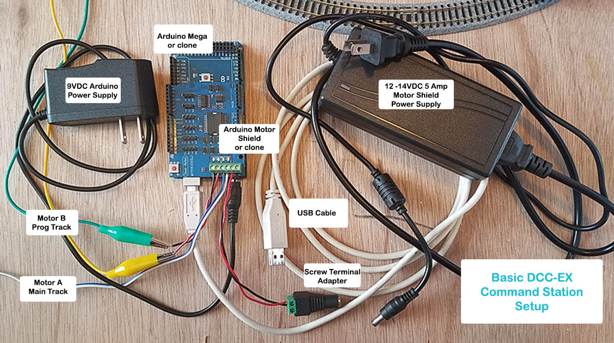
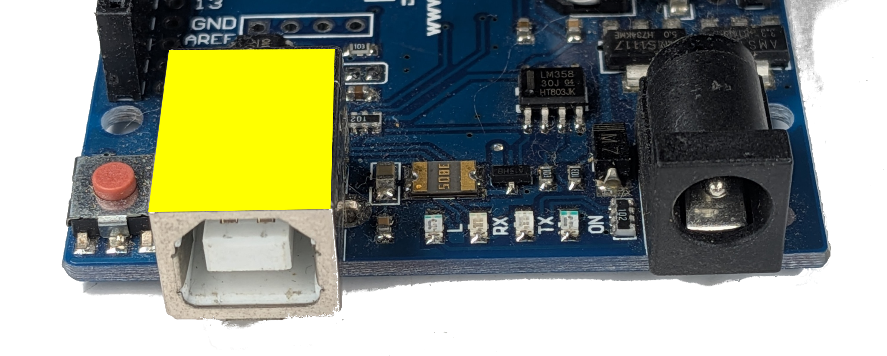
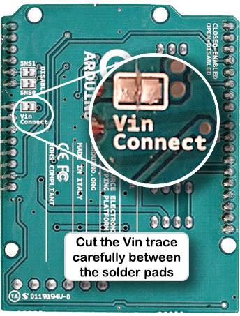
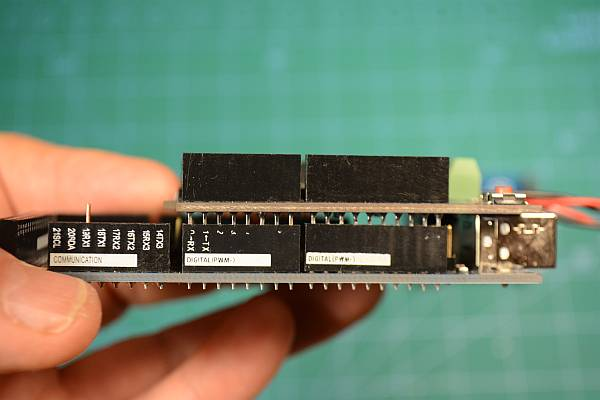
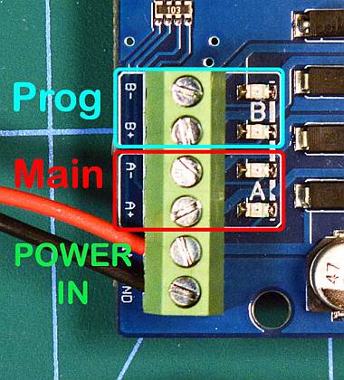
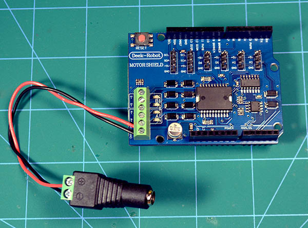

# Alternative build - Arduino Mega + Arduino Motor Shield

!!! note ""
    The instructions on this page are the steps required to use an Arduino Motor Shield motor shield, or other supported motor driver, to build an **EX-CommandStation**.  
    To use the **EX-MotorShield8874**, or other supported motor driver, refer to the [easy build page](mega-easy.md).

These instructions assume a slightly more competent user who has made the decision to trade simplicity for price. It is assumed that you are comfortable modifying devices, maybe soldering etc. and are not going to make costly mistakes such as mixing up the power supplies or putting the processor board down on something that will short the underside of the pins.

There are a limited number of suitable motor or WiFi shields available and each has its own quirks.

!!! Note ""

    Note: The Arduino UNO is no longer supported by the current version of the **EX-CommandStation** software, but it is still possible to install older versions on an Arduino UNO if really needed.

## What you need

{ width=600px }

To build a basic DIY **EX-CommandStation** you will need:

- A PC or laptop (Not A Raspberry Pi) running a reasonably recent versions of Windows, Linux or MacOS
- An Arduino Mega microcontroller running our free Open Source software
- USB cable to your PC for the processor.
- an Arduino Standard Motor-Shield (or others as noted in the [motor shields list](../reference/hardware/motorboards/index.md)) to power the track.
- A double-insulated DC [Power supply](power.md) with a voltage suitable for your layout/locos.
- An additional double-insulated DC [Power supply](power.md) is needed to drive the Arduino microcontroller.
  7 to 9 volts, using the barrel connector, is recommended when using a WiFi shield.
  5 volts will not work for the barrel connector, but could be connected via USB cable.
- Optionally
    - A female barrel connector to match the plug on your chosen track power supply
    - A suitable WiFi shield to use WiFi throttles (recommended) with 2 suitable M-F Dupont wires.

        OR

    - An Ethernet Shield

----

## Step By Step Build

### 1. Prepare your Mega

{ align=right width=300px }

- If you have an older Arduino Mega with the large USB-B type connector, use kapton tape, electrical tape, sticky tape or similar to cover the top of the USB connector on the mega. This prevents any accidental contact with the underside of the motor shield.
    *Not required for later Megas that came wth MicroUSB or USB-C connectors.*

- Mount your Mega on a 3D printed tray, a piece of plastic card or wood to make sure that the underside solder points are insulated.

    This prevents damage to the boards from an electrical short, if you accidentally place your **EX-CommandStation** down on a tool, coin or even your track.

### 2. Optionally mount your Ethernet Shield - ***OPTIONAL***

Note, you can't have Ethernet and WiFi running on the same **EX-CommandStation**, but you can install both shields and choose one or the other when installing the software.
See the [Ethernet Install](ethernet.md) page for more information.

### 3. Prepare your motor shield

{ align=right width=300px }

**˅˅˅ WARNING - WARNING - WARNING ˅˅˅  
FAILURE TO DO THIS CAN DESTROY YOUR MEGA**

- You *MUST prevent the shield from feeding track voltage into your Mega*. This is done by cutting the VIN trace and/or removing the pin that feeds the Mega.

    Recommended: If you have a multimeter, once cut, confirm that there is no conductivity between the two pads.

    *Note: This is not required if you are using an **EX-MotorShield8874** motor shield ([covered here](mega-easy.md))*.

    **˄˄˄ WARNING - WARNING - WARNING ˄˄˄**

- Ensure shield pins are straight and correctly aligned.

### 4. Mount the motor shield

{width=300px align=right }

Align the motor shield so that the power connectors are at the same end as the Mega power/USB connectors. 

It is normal for you to see a few millimetres of the pins between the bottom of the motor board and the top of the headers.

### Connect your track

{ align=right width=300px }
Don't skip this step if you don't yet have any track because the WiFi shield will cover the connectors.

It's best to create fly leads with a suitable pluggable connectors for later. It makes it much easier to detach your **EX-CommandStation** from your layout when you need to fiddle with it later.

If you only have one piece of track for testing, wire it to the PROG track plug.

- The MAIN track is wired to the A channel output.
- Your PROG track is wired to the B channel output.

### 5. Connect your track power supply

{ align=right width=300px }
Wire your track power supply to the input turrets of the motor shield, observing polarity. It is best to create short wire with a female barrel connector.

### 6. Connecting your Arduino Mega power supply

You will need to connect to a 7-9vDC [Power supply](power.md) to the Arduino Mega before you can run your trains, but it is not required until after you have installed the **EX-CommandStation** software. The USB connection from your PC will provide sufficient power initially.

### 7. Optionally install a WiFi Shield - ***OPTIONAL***

See the [WiFi Install](wifi.md) page for more information.

### 8. Connect to your PC

Using a suitable USB cable (must carry both Data and Power, not all cables do this!) connect the Mega USB to your PC.

### 9. Load the software

Congratulations, you have built a DIY **EX-CommandStation**. But you now must load the software to be able to use it.

For simplicity, software loading is best done with the [EX-Installer](installer.md)
