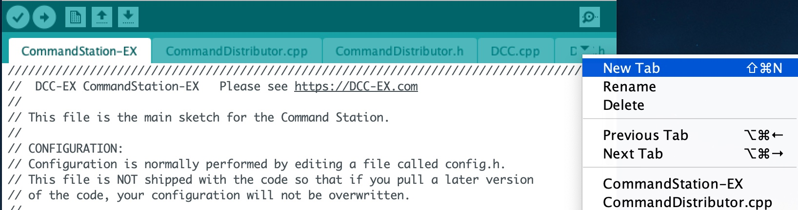
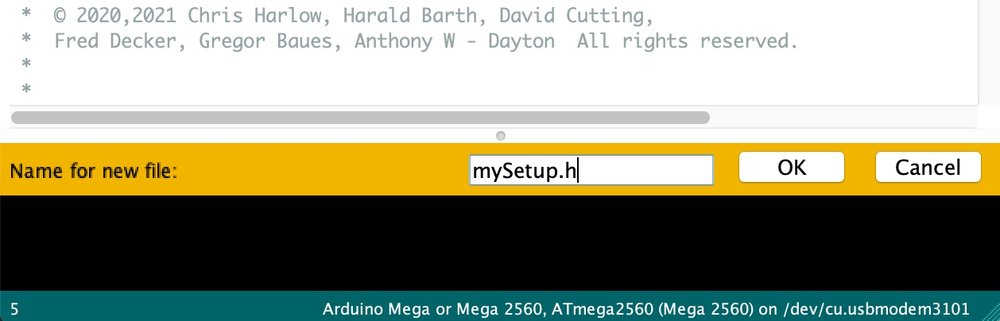

# Startup Configuration

Sometimes, you may want to configure your EX‑CommandStation with settings which are not otherwise saved by the Command Station when restarted. For example the ACK min for the Hornby R7150 Decoder (which seemed to need its minimum ACK pulse duration limit set to 2600µS to be recognised).

To automatically run commands at start up, you can create a new file called mySetup.h to contain these commands.

How you create the file will depend on how you load the EX‑CommandStation software onto your Arduino.

- By using [EX‑Installer](#if-you-are-using-ex-installer)
- By using the [Visual Studio Code (VSC)](#if-you-are-using-visual-studio-code-vsc)
- By using the [Arduino IDE](#if-you-are-using-the-arduino-ide---not-recommended) - ***Not recommended***

----

## If you are using EX-Installer

You need to create a text file in the CommandStation-EX folder below where you uncompressed the EX‑Installer files, and rename it to mySetup.h

For example, in Microsoft Windows:

For example, in Microsoft Windows:

- Open the <cite>File Explorer</cite> app
- Navigate to where you unzipped the [EX‑Installer](https://dcc-ex.com/ex-installer/index.html) files that you downloaded from this site.
- Open the <cite>CommandStation-EX</cite> sub-folder
- In the ‘Home’ tab, click `New Item` and then `Text Document`
- Replace the name with <cite>mySetup.h</cite> and press `Enter` It will warn you about changing the extension (the bit after the ‘.’). Click `yes`.
- [Right click] on the new file, and select Open With ‣ Notepad
- The file will open in the ‘Notepad’ app
- Enter the commands you need to perform. For Example:

```c++
    SETUP("<1>"); // Turn track power on at startup
```

- Select ``File`` ‣ ``Exit``.  
It will ask you the save the file. Click ``Save``
- You now need to upload the software using the [EX‑Installer](../../prepare-to-use/installer/index.md) just the same as you originally did to [Install the Software](../../prepare-to-use/installer/install-cs.md)

See examples and information below for adding multiple instructions to ``mySetup.h``.

----

## If you are using Visual Studio Code (VSC)

==TODO== Uploading via VSC

----

## If you are using the Arduino IDE - Not Recommended

This will need to be done in the Install using the Arduino IDE, so first make sure you have followed these steps to load up the Arduino IDE.

!!! IMPORTANT "Arduino IDE is not recommended"
    A word of caution on using the Arduino IDE to install the software:  
    While it is possible install the software using the Arduino IDE, we seriously ***DO NOT RECOMMEND IT*** for a novice users. It is an order of magnitude more complex, much slower, and with a very high probability of getting something wrong unless you really know what you are doing.  
    The **EX‑Installer** will meet 100% of the needs of a most users with considerably less effort.

## Create a new tab

First you will need to add a new file, just like the config.h file. Create a new tab using the following menu option.



## Creating the mySetup.h file

At the bottom of the Arduino IDE window, a yellow bar will appear asking for a Name for new file, here make sure to enter mySetup.h (case sensitive, so upper case S in setup) and click OK to create the new file.



Adding in the startup commands
Within the new file that has been created, you can add in the commands that you wish the Command Station to run at startup. For example, if you need to run the following command each time your Command Station starts up:

```c++
<D ACK MIN 2600>
```

Then you would need to enter into the mySetup.h file:

```c++
SETUP("<D ACK MIN 2600>");
```

Note the upper case word SETUP at the start.

Adding in more than one startup command
If you need to have multiple commands run at start up, you will need to enter each additional command on a new line, so a longer mySetup.h file could look like:

```c++
SETUP("<D ACK MAX 9200>"); // Set ACK detection to allow pulses up to 9200uS
SETUP("<D ACK LIMIT 60>"); // 60mA is the default
SETUP("<0>"); // tracks off at startup
SETUP("<D CMD 0>"); // can be set to ON for testing in the serial monitor
```

Here you can add comments on each line, these can be added by using the double forward slash character // and then your comments. This makes it easier to remember why you added these start up commands.

Upload the new version of the software
Finally, upload the code to the Arduino as you would do during the standard Arduino IDE Setup. Restart the Command Station and these commands will have run at start up.

## Examples

Automatically Turning Track Power on at Startup
Adding this line to mySetup.h will cause the track power to turn on automatically when the **EX‑CommandStation** powers up.

```c++
SETUP("<1>");  // Turn track power on at startup
```

--8<-- "snippets/abbr.md"
