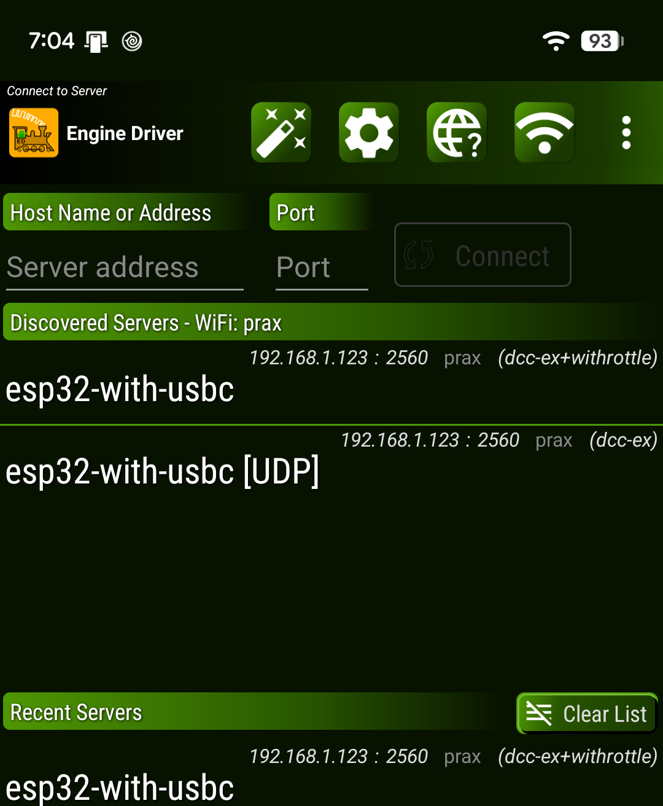
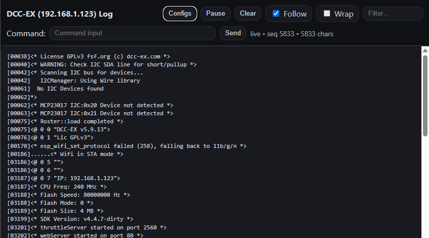
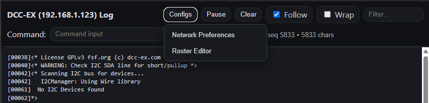
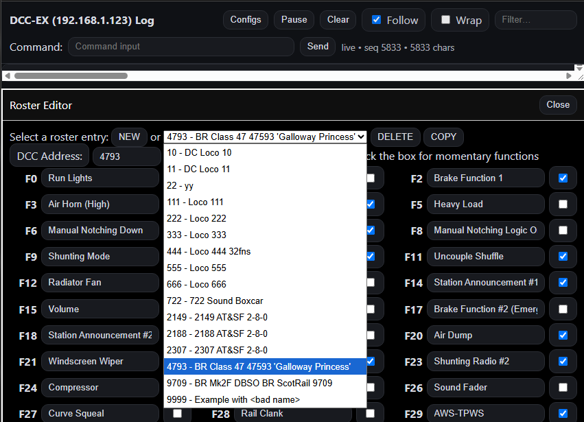
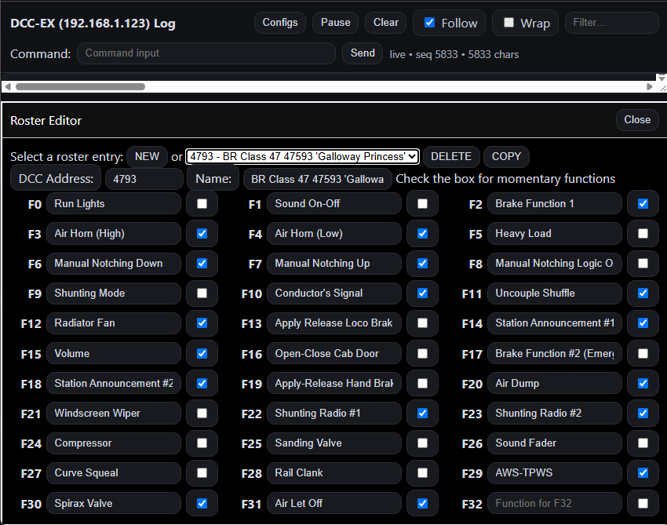
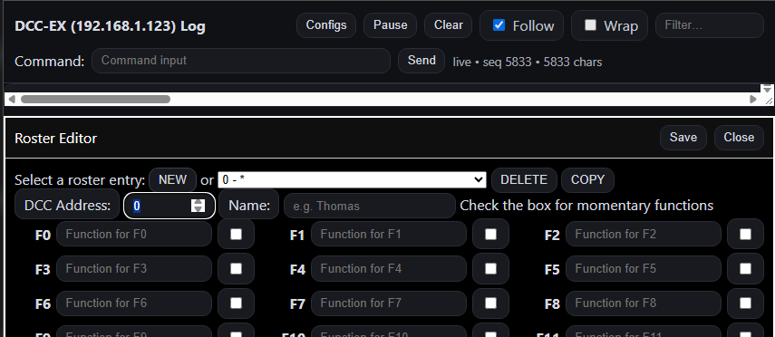
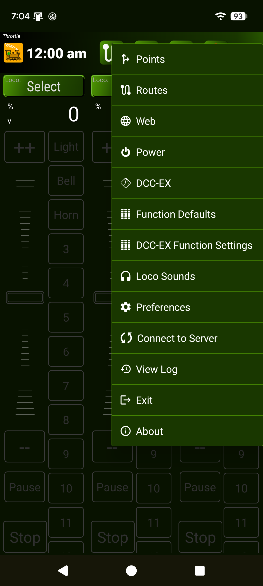
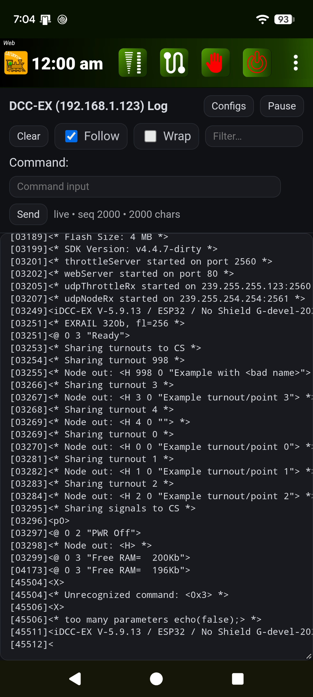

---
tags:
  - _9J9_9R9_locoid_name_functionMap
  - _9J9_9R9_9SAVE9
  - _9J9_9R9_id_9DELETE9
---

# Roster

The Roster is a list of loco DCC addresses, with names for convenience and a list of named/labelled function keys that are supported by each loco decoder.

## How to create a Roster

There are three ways to create or manipulate a roster

* [In a Web Browser](#roster-editing-with-a-web-browser)
* [In EXRAIL](#roster-in-exrail-as-per-previous-versions)
* [With Serial Commands](#roster-serial-commands)

----

## Roster Editing with a Web Browser

!!! note ""

    {{new_in_v("6.0")}} Available in version 5.9.13 and above of **EX-CommandStation** only.

When using a web browser dialog on the command station, the Config.. Roster Editor menu will show a roster editing dialog. This edits and saves roster entries in RAM.

==TODO== VERY HIGH! - needs detailed instructions for Roster Editing with a Web Browser. Needs to include screenshots!

Enter the IP address of the **EX-CommandStation** into the address bar of you browser. e.g. ``192.168.1.4`` if you are using the default [Access Point](../prepare-to-use/installer/config-wifi-esp32.md#the-wifi-different-modes) mode.
Or use the Web Page in Engine Driver, after you have connected to the **EX-CommandStation**.

To find the IP address:

* If you have an OLED screen, it will tell you the IP address of the **EX-CommandStation**
* The Engine Driver app (and most other throttle apps) will tell you the IP address of the **EX-CommandStation** on the connection screeen

{ width=200px }

Using a PC Web Browser:

{ width=500px }

{ width=500px }

{ width=500px }

{ width=500px }

{ width=500px }

Using Engine Driver's Web page:

{ width=200px }  { width=200px }

* Click ``Configs`` then select ``Roster Editor``

* To add a new roster entry...

* To edit an existing roster entry...

* To save the roster entries to ???...

* To delete a roster entry...

----

### Roster in EXRAIL (as per previous versions)

Roster entries in EXRAIL are compiled into the command station and therefore are backward compatible with previous versions. On startup the **EXRAIL** ROSTER entries are loaded into RAM before any locally saved roster entries are loaded from non-volatile storage on the command station.

See the [EXRAIL Rosters](../enhance/exrail/exrail-objects-introduction.md#adding-a-roster) page for more information.

----

## Roster Serial Commands

!!! note ""

    {{ new_in_v("6.0") }} Available in version 5.9.13 and above of **EX-CommandStation** only.

There are a selection of roster commands which are normally used by throttles to extract roster information from the command station.

`<JR>` returns a list of the DCC loco addresses in the roster, e.g.
`<jR 3 5 100>`

`<JR 100>` Returns details for DCC address 100 e.g.
`<jR 100 "Thomas" "Lights/*Whistle/Squeal">`
The functions are separated by '/' and a '*' prefix indicates that the function is momentary rather than toggled.
A request for a roster that does not exist (eg `<JR 999>`) is returned as `<jR 999 X>`

New Roster commands for v5.9.13 and above:

`<JR id "name" "functions">`  adds or replaces a roster in RAM.

`<JR id DELETE>`  removes a roster entry from ram.

`<JR SAVE>`  saves the current rosters in ram. They will be reloaded again at startup.

See the [Roster Serial Commands](../reference/serial-commands/serial-command-jj-rr_not_in_nav.md) reference page for more information.

See the [using a serial monitor](../reference/tools/serial-monitor.md) page for information and options on how and where to enter serial commands.

--8<-- "snippets/abbr.md"
