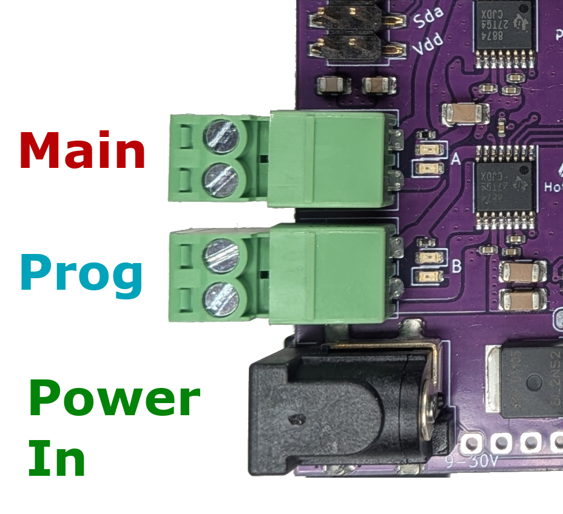
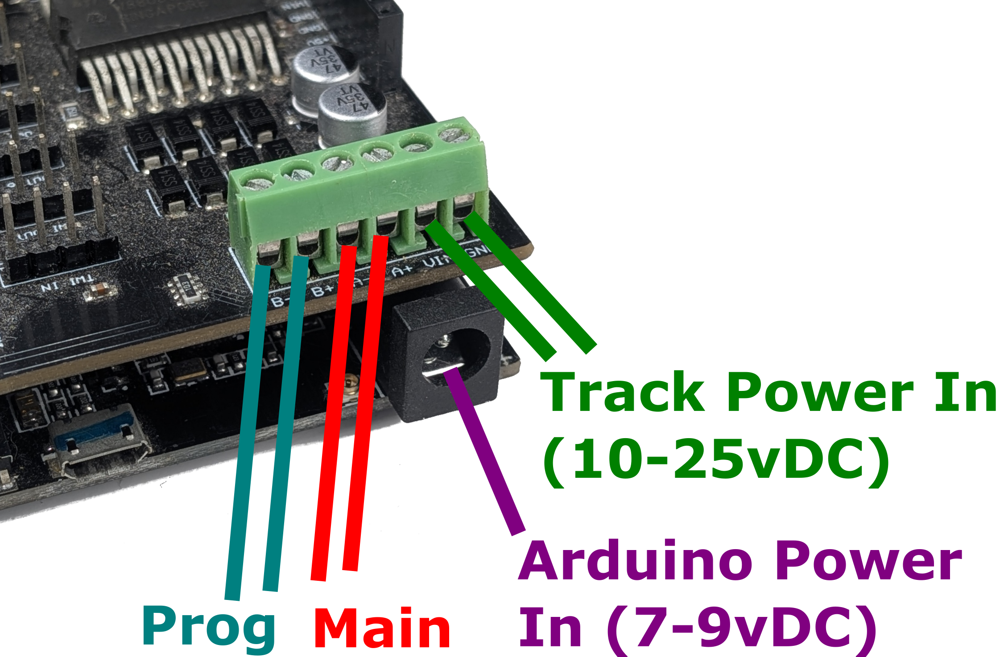

# Connecting to your layout

This page explains how to connect your self built **EX-CommandStation** to your layout and programming track.

!!! Note ""

    This page is for self built **EX-CommandStations** only. If you have an **EX-CSB1** please refer to the [corresponding page](connecting-ex-csb1.md).

How you connect your self built **EX-CommandStation** to your layout changes slightly depending on the Motor Driver that you used in your self build.

- If you used an **EX-MotorShield8874** see the [EX-MotorShield8874](#connecting-an-ex-motorshield8874) section below
- If you used a Standard Arduino Motor Shield see the [Standard Arduino Motor Shield](#connecting-a-standard-arduino-motor-shield) section below
- If you have used another type of motor driver see the [other motor drivers](#connecting-other-types-of-motor-driver) section below

----

## Connecting an EX-MotorShield8874

<!-- ==TODO== MEDIUM - This section could be improved. Physically connecting DIY EX-CS to a layout - EX8874 -->

The **EX-CommandStation** needs the minimum following connections to be able to run trains:

{ width=200px align=right }

- **Power input on the 2.1mm black barrel connector** –  accepts 10-25V DC fully regulated, preferably a modern switch-mode power brick, double-insulated with good power overload protection. See the [selecting power supply](../../diy/power.md) page for information on selecting a suitable power supply.
- At least **one track connection** – on either the Track Output A (topmost) or Track Output B (beside the power) connector.

    Note that by default, A is configured for DCC MAIN operation, and B is configured for PROG or programming track. We recommend connecting your track to the A MAIN output initially to test running of trains.

## Connecting a Standard Arduino Motor Shield

<!-- ==TODO== MEDIUM - This section could be improved. Physically connecting DIY EX-CS to a layout - Standard Arduino Motor Shield -->

The **EX-CommandStation** needs the minimum following connections to be able to run trains:

{ width=300px align=right }

- **Power input for the motor shield** –  accepts 10-25V DC fully regulated, preferably a modern switch-mode power brick, double-insulated with good power overload protection. See the [selecting power supply](../../diy/power.md) page for information on selecting a suitable power supply.

- **Power supply for the Arduino Mega**.  This can be either:

    - **7-9v DC power input on the 2.1 barrel connector** - Recommended
    - **USB power** - Not recommended. Powering with a USB power supply generally works, but may cause other issues later.

- At least **one track connection** – on either the Track Output A (beside the power) or Track Output B connector.

    Note that by default, A is configured for DCC **MAIN** operation, and B is configured for **PROG** or programming track. We recommend connecting your track to the A MAIN output initially to test running of trains.

!!! note "Why does the standard motor driver need an extra power supply?"

    For Arduino Mega with Either the 'Arduino Motor Shield R38' or 'Deek-Robot Motor Shield', you need at least two different voltages. The Arduino needs ~5vDC and the Motor driver needs significantly more voltage to provide power to the track (see below).

    Both your microcontroller (the Arduino) and the motor driver need power. While we recommend a 7-9 Volt, 1 Amp, DC power supply for an Arduino Uno or Mega, there are other ways to power it.

    The voltage requirement to the motor driver does not change based on how you power your Arduino, you need the correct voltage and amperage for your scale/gauge and layout.

## Connecting other types of Motor Driver

==TODO== physically connecting DIY EX-CS to a layout - Other Motor Shields

--8<-- "snippets/abbr.md"
