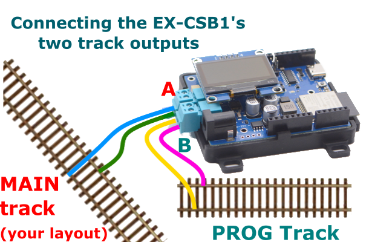

# Connecting the EX-CSB1 to Your Layout

==TODO== this page needs to be expanded

How to connect your **EX-CSB1** to your layout and programming track.

Note: This page is for the **EX-CSB1**. If you have an self built **EX-CommandStation** please refer to the [corresponding page for the EX-CSB1](connecting-diy.md)

{ width="100%" }

The **DCC-EX EX-CommandStation/Booster 1 Express (EX-CSB1)** needs the minimum following connections to be able to run trains:

- **Power input on the 2.1mm black barrel connector** –  accepts 10-25V DC fully regulated, preferably a modern switch-mode power brick, double-insulated with good power overload protection. Minimum current capability of 4A, suggested 12-16V for Z, N or HO/OO scales, with DCC+Sound locos generally wanting 14-16V even in N scale.
- **One track connection** – on either the Track Out A (topmost) or Track Out B (beside the power) connector. Note that by default, A is configured for DCC MAIN operation, and B is configured for PROG or programming track. We recommend connecting your track to the A MAIN output initially to test running of trains.

    { width="400px"}

When correctly supplied with track power, both green Power LEDs will light. If the right-most LED alone is lit, it indicates power is being supplied from the USB-C connector so software upload can proceed, but trains cannot be run.

The Wi-Fi LED will light once a Wi-Fi network is created (Access Point mode), or once connected to an existing Wi-Fi network (Station mode.)

--8<-- "snippets/abbr.md"
