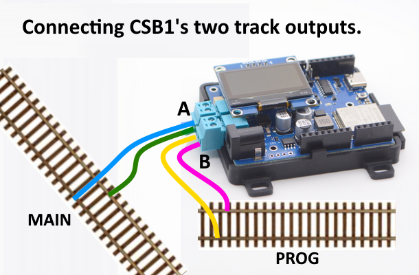

# **EX-CSB1** - Quick Start EX-CommandStation/Booster 1 Express

{ .only-light width=400px align=right }
{ .only-dark width=400px align=right }

This is the **EX-CSB1** *Quick* Getting Started Guide.  See ==TODO== for a detailed guide on setting up and using the **EX-CSB1**.

  

{ width="200" }

## Connecting

{ width="100%" }

The **DCC-EX EX-CommandStation Booster 1 Express (EX-CSB1)** needs the minimum following connections to be able to run trains:

- **Power input on the 2.1mm black barrel connector** –  accepts 10-25V DC fully regulated, preferably a modern switch-mode power brick, double-insulated with good power overload protection. Minimum current capability of 4A, suggested 12-16V for Z, N or HO/OO scales, with DCC+Sound locos generally wanting 14-16V even in N scale.
- **One track connection** – on either the Track Out A (topmost) or Track Out B (beside the power) connector. Note that by default, A is configured for DCC MAIN operation, and B is configured for PROG or programming track. We recommend connecting your track to the A MAIN output initially to test running of trains.
{ width="400px"}

When correctly supplied with track power, both green Power LEDs will light. If the right-most LED alone is lit, it indicates power is being supplied from the USB-C connector so software upload can proceed, but trains cannot be run.

The Wi-Fi LED will light once a Wi-Fi network is created (Access Point mode), or once connected to an existing Wi-Fi network (Station mode.)

Other Connectors:

- **Qwiic I2C connector** – allows a broad range of 3.3V I2C peripherals to be easily with simple cables.
- **Railsync connector** – allows connection to Railsync or a DCC track signal for Booster and Sniffer modes when enabled with suitable software configuration.

## Booster mode

When configured correctly, connecting a Railsync or DCC signal to the Railsync connector will enable your **EX-CSB1** to operate as a booster.

Refer to the [EX-CSB1 in DCC Booster Mode](/products/ex-commandstation/trackmanager/booster.md) page for information on how to configure the software to enable this.
