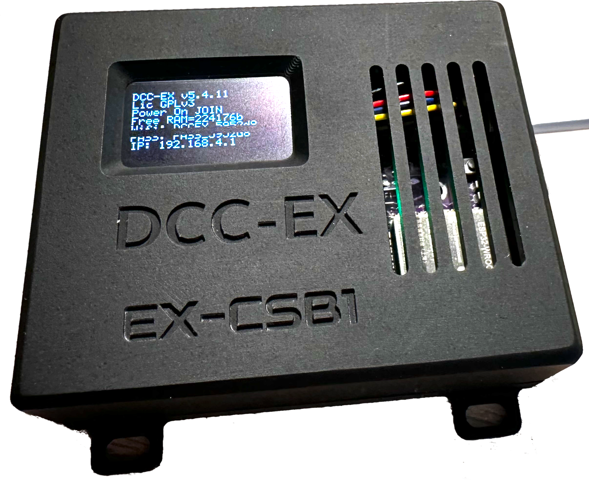
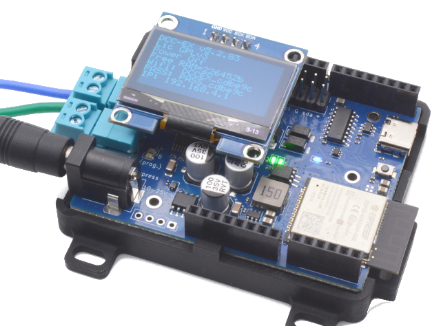

# **EX-CSB1**  <small>EX-CommandStation/Booster 1 Express</small>

{ .only-light width=400px align=right }
{ .only-dark width=400px align=right }

The **EX-CommandStation/Booster 1 Express** (**EX-CSB1**) is our flagship, WiFi enabled, *ready-to-run* system and is available for [purchase now](../../purchasing/official-sellers.md).  
With your phone, you could be running your trains in less than 5 minutes. *No computer required.*

{ width="200px" } { width="200px"}

## Features

The **DCC-EX EX-CommandStation/Booster 1 (EX-CSB1)** comes ready to use out of the box and has the following features:

- All the features of our [**EX-CommandStation** Software](../ex-commandstation/index.md)
- **Dual DCC/PWM DC outputs with up to 5A capacity** – easily expandable to 4 outputs
- **Wi-Fi built-in** – fast 802.11n capable, with Access Point and Station modes including support for connecting as many as 10 Wi-Fi throttles (you can also connect to JMRI via Wi-Fi, but a USB cable is often better)
- **Single power supply for track and onboard electronics** – 12-25V DC with polarity protection
- **USB-C connector** – for software upload, diagnostic monitoring, **DCC-EX** **EX-WebThrottle** and JMRI connectivity
- **Railsync DCC input** – enables Booster or Sniffer modes, which with an **EXRAIL** script can be automatically engaged on receipt of a signal
- **OLED screen** – for diagnostics, status and information display
- When configured correctly, connecting a Railsync or DCC signal to the Railsync connector can enable your **EX-CSB1** to operate as a [DCC booster](../../enhance/trackmanager/booster.md).
- When configured correctly, any output can be used as a [DCC Auto Reverser](../../enhance/trackmanager/index.md)

## Purchasing

To purchase your own **EX-CommandStation/Booster 1 Express** (**EX-CSB1**) see our [Official Suppliers page](../../purchasing/official-sellers.md).
