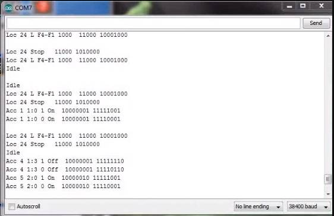

# EX-DCCInspector

{ .only-light width=400px align=right }
{ .only-dark width=400px align=right }

==TODO== MEDIUM - This page needs to be expanded

EX‑DCCInspector is a packet sniffing tool that can connect directly to the signal pins on the Command Station or to the track depending on your circuit. For information in the [Diagnostic Tools Section](../../reference/tools/index.md).

{ width=200px align=left }
[EX-DCCInspector source code Zip file](https://github.com/DCC-EX/DCCInspector-EX/archive/refs/heads/main.zip)

[EX-DCCInspector Github Repository](https://github.com/DCC-EX/DCCInspector-EX)

--8<-- "snippets/abbr.md"
