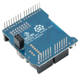

# EX-WiFiShield 8266

{ .off-glb .only-light width=400px align=right }
{ .off-glb .only-dark width=400px align=right }

The v1.1 WiFi shield is a joint **DCC-EX** and Makerfabs project. It comes already flashed with **DCC-EX** **EX-CommandStation** compatible firmware.

{ align=right}

The **EX-WiFiShield 8266** is a cost-effective and highly integrated UART-WiFi module for **DCC-EX**. It comes in a standard Arduino Uno shield format.

!!! note "Recommended for use with Arduino MEGA based DIY **EX-CommandStations**."

    Not required for the **EX-CSB1** or ESP32 based **EX-CommandStations**.

This WiFi Shield is based on the new version of the ESP-12F with the Wifi chip ESP8266.  With this Shield, you can connect your **EX-CommandStation** to your home Wifi network, or have it operate as a stand alone Access Point to connect directly from your phone, tablet, laptop, or WiFi hardware throttle.

## Features

- Wireless 2.4GHz 802.11 b/g/n
- supports the STA/AP/STA + AP operation modes
- Built-in TCP/IP protocol stack
- multiple TCP Client connections
- Supports Smart Link intelligent networking
- Dimensions: 2.1"(53mm) x 1.9"(47mm) x 0.9"(23mm)

## Purchase

The **EX‑MotorShield8874** is available from many [suppliers](/purchasing/official-sellers.md).

## Assembly

Follow the simple assembly instructions, Mega and Nucleo installs are essentially the same.

- [WiFiShield8266 install](../../diy/mega-easy.md#3-optionally-install-wifishield-optional)

--8<-- "snippets/abbr.md"
