# EX-CSB1 Extended Quick Setup Guide

This quick startup guide is designed to have you configured and setup to run trains in 5 minutes. After all, the point is to enjoy running trains, not sifting through more information than you need until you are ready.

These instructions are for DCC locomotives. For more detailed information, to configure for running DC trains, or to use different throttles like [EX‑WebThrottle](../../products/ex-webthrottle/index.md) or JMRI, see the [EX-CSB1 Operating Manual](ex-csb1-full-guide.md)

----

## What You Will Need

- An **EX‑CommandStation/Booster One Express** [^1]
- A **Power supply** (12-16v DC see [Power Supplies](../../purchasing/power.md)) [^2]
- A **DCC loco** (If you are here to run DC locos, please go to the [TrackManager (DCC & DC)](./../../enhance/trackmanager/index.md) page.)
- Some **Track**
- **16 to 28AWG/1.5mm^2 Wire**, preferably in 2 colours with 1/8'/6mm insulation stripped (and wire tinned if stranded)
- Jeweller's **flat bladed screwdriver** (1.5 - 2mm blade)
- A **WiFi capable smart device** like a phone or tablet to control your trains (aka a 'Throttle')

[^1]: While not required for normal use, a PC is required a) to initially install the software on a DIY system, b) is optional for making a USB connection and using programs like **EX‑WebThrottle* or JMRI, and c) to update/add **EXRAIL** Scripts to the **EX‑CommandStation** or make other changes to its configuration. <br/> A USB connection also provides a connection to a 'serial monitor' to generate logs and diagnose issues. But more on that later.

[^2]: The voltage you need for the [Motor Driver](../../purchasing/power.md) depends on the scale/gauge of the layout you are using. Bigger is not always better. Too high a voltage can damage your locos. See the [Powering the Motor Driver](../../purchasing/power.md) for more information.

----

## Board Layout

{ width="500px" }

A full explanation of the board is available in the [manual](ex-csb1-full-guide.md).

!!! Warning "Start with all power disconnected!!"

    Before connecting any wires to your command station or tracks, make sure you have unplugged the power supply from the wall or removed the barrel connector from the command station.

    It is crucial to ensure that the command station has no power while you are working on your connections.

----

## Summary or Super-Quick Start

In summary, you need just two basic wiring connections to the **EX‑CommandStation/Booster One Express** to be up and running trains:

1. Track connected to Track A Output
2. Power supply input connected to Power IN DC barrel jack

!!! Note inline end "Engine Driver & EX-Toolbox"

    There are quite a few custom features in [Engine Driver](../../throttles/engine-driver.md) and [EX‑Toolbox](https://dcc-ex.com/ex-toolbox/index.html). It may be worth getting a cheap Android phone or tablet just to be able to use those apps

And to connect via WiFi to the **EX‑CSB1** to control trains your smart device will need either:

- [Engine Driver](../../throttles/engine-driver.md) or [EX‑Toolbox](../../products/ex-toolbox/index.md) for Android
- [ThrottleCard](../../throttles/throttlecard.md) for Apple iOS

----

These are the most basic steps to get you up and running. If you need more help, then remainder of this page explains these steps in much greater detail.

### Steps

1. Connect your EX-CSB1 to your track**

    Connect your main track to the `A` **MAIN** output to your Command Station.

2. Connect power to your EX-CSB1**

    The **EX‑CSB1** has a 2.1mm x 5.5mm power jack. Connect this to an appropriate DC power supply.

    For N and HO scale you would normally use a 12v to 16v DC [power supply](../../purchasing/power.md)[^2], but be sure to check the manual for your loco/decoder combination for the correct voltage.

3. Connect Your Smart Device(Phone) to the 'DCCEX\_xxxxx' WiFi Network**

    An Android Phone or Tablet or Apple iOS Phone or Tablet can be used.

    - Open the Wifi Settings in your smart device.
    - Select the WiFi network in your smart device WiFi settings named `DCCEX_xxxxxx`, and use the corresponding password `PASS_xxxxxx` (where **xxxxxx** is identical in each case) which is shown on your EX-CSB1's OLED display.
    - Tell your smart device not to worry about there being no Internet connection. [^4]

[^4]: You also may need to tell your smart device to not automatically connect to your default WiFi network or it might keep trying to reconnect to that instead

4. Connect Your Controller (Throttle) App to the 'dccex' Server**

    - Launch your throttle app. [^5]
    - In your throttle app, connect to the `dccex` server.

[^5]: **wiThrottle**, and some other apps, will require you to enter the IP address and port of the server manually. <br/>The IP address is usually `192.168.4.1` when using Access Point mode, and the port is `2560`. <br/>Refer to your app's documentation for details on how to enter these settings.

5. Acquire a Loco in Your Controller (Throttle) App**

    - Place a working DCC equiped loco, with a known DCC Address, on the track
    - Acquire that loco using its DCC Address

6. Run Trains

    - Run/control the loco

These quick tips may have been be enough to get your running, but step by step instructions follow below.

----

## Connecting your Command Station

### Track Connection

There are 2 track output power connectors marked `A` and `B`. In the standard DCC-EX configuration of a **EX-CSB1**, `A` is configured for DCC **MAIN** operation, and `B` is configured for **PROG** or programming track output.

We recommend connecting your track to the `A` **MAIN** output initially to test your Command Station.

To alter this default configuration of DCC outputs, or for DC Mode, you would need to configure outputs with a TrackManager command in the `mySetup.h` file or by creatine a 'Route'. See the [TrackManager](../../enhance/trackmanager/index.md) page for details.

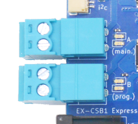{ width="200px" }  
The pluggable male screw terminals accept to 16 to 28 AWG/1.5mm^2 gauge solid or stranded wire.

If you use stranded wire, we recommend 'tinning' the ends of the wire to make a good connection and ensure that stray wire whiskers don't stray outside the screw terminals and cause a short circuit.

!!! note inline end "Wire gauge"

    See [DCC Track Wiring Information](../../reference/wiring/wire-gauge.md) for more information or wire gauge.

Larger wire can handle more current and provide less resistance. 18-22 AWG usually good. Keep your wires short by mounting the Command Station close to the track.

Using a small flat-bladed screwdriver, loosen both screws on the MAIN (A) Track Output being careful not to screw them all the way out. The screws just need to be loosened enough to fit your wires into the holes. Tighten down both screws once you have inserted the wires making sure to not overtighten.

You can pull the connector out of its socket to remove it from the **EX-CSB1** to make this easier. Remember push the connector all the way into the connector on the board to snap it back in place.

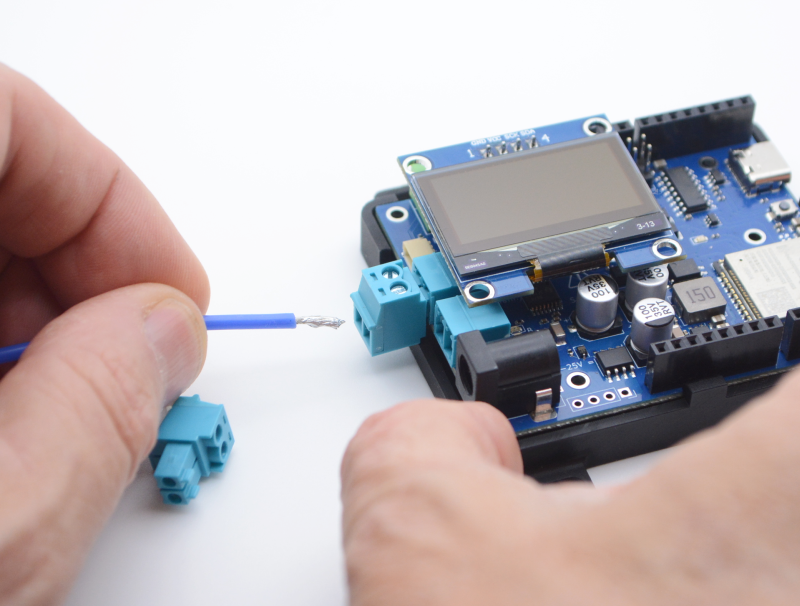{ width="200px" }  
Inserting wires

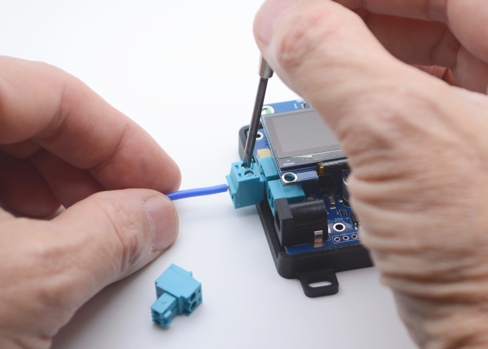{ width="200px" }  
Tightening Screws

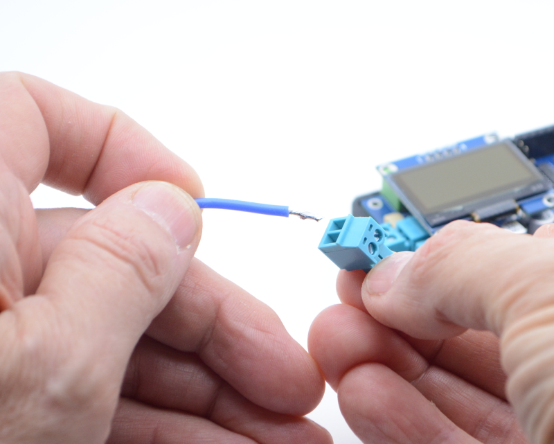{ width="200px" }  
Optionally unplugging connector to insert wires

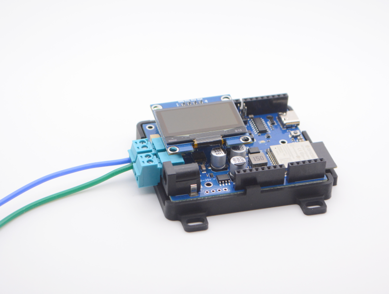{ width="200px" }  
Wires properly inserted and plug inserted

!!! Note ""

    The power connection to your track will be either wires you solder yourself to the rails or via a power connector that plugs into track (such as Kato Unitrack). We will leave it up to you to determine the proper connection to your track.

Connect the other ends of the track output wires to your track. While not critical at this stage when using DCC. It is best to keep to a standard where the RED wire (or striped wire) is connected to the outside rail of the track to make things easier when using feeders to track sections or adding reversing loops.

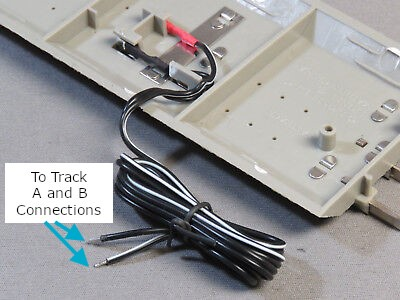{ width="200px" }  
Connecting Wires to Track

### Power Connection

The **EX-CSB1** has a 2.1mm x 5.5mm power jack. If you already have a power supply with bare wires, you can use an optional 2.1mm x 5.5mm screw terminal block adapter.

For N you would normally use a 12v to 14v power supply and HO scale you would normally use a 12v to 16v DC power supply, but be sure to check the manual for your loco/decoder combination for the correct voltage [^2].

For more information about power supplies, including how to use one power supply to supply all the different voltages on your layout, see the [power supplies](../../purchasing/power.md) page.

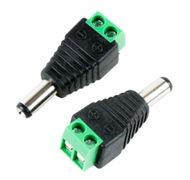{ width="200px" }  
2.1mm screw terminal adapter

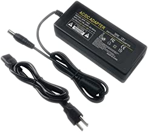{ width="200px" }  
12v 3A brick power supply

## Testing Your Command Station

### Connect Track Input Power

To fully power the **EX‑CommandStation/Booster One Express**, just plug your power supply into the mains power (aka wall outlet) and connect the barrel end to the Command Station.

Make sure your power supply matches the needs of your setup: the voltage should be between 12v and 25v DC, depending on the scale of your locomotives [^2], and it should provide at least 2A of current with good over-current performance and voltage stability.

To get the most out of your **EX‑CSB1** we suggest using a modern switching power supply with 4A or more. For Z scale, 12v is usually enough, but for N we recommend using between 12v and 14v, and for HO/OO scales we recommend using between 14v and 16v DC [^2].

It's important that your DC power is well-regulated which is why we suggest a modern switch-mode power supply with double insulation and strong overload protection.

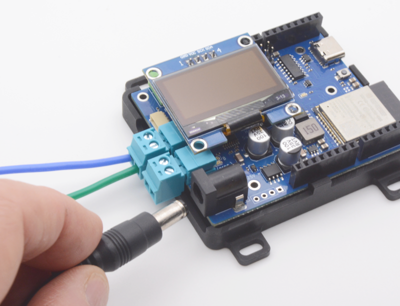{ width=200px }  
Inserting Power Supply Barrel Plug

When you connect power to the **EX-CSB1** via the barrel connector, you should see both bright green power LEDs light up (5V and 3.3V power), confirming that the electronics are working.

However, for safety, track output power will be off by default when you first plug in the **EX-CSB1**. This is to prevent power from accidentally being applied to your layout before everything is ready. If you prefer, you can change this default setting in the [Startup Configuration](../../enhance/exrail/exrail-startup-configuration.md).

{ width="200px" }  
Barrel Plug Power LEDs

You should see status information on the display including the **EX-CSB1** firmware version, track power status, free memory, and WiFi connection information.

If you do not have a display, you will need to connect a [Serial Monitor](../../reference/tools/serial-monitor.md) to see the status, but this is not essential for ongoing use of the system. (See: [Using a Serial Monitor](../../reference/tools/serial-monitor.md)).

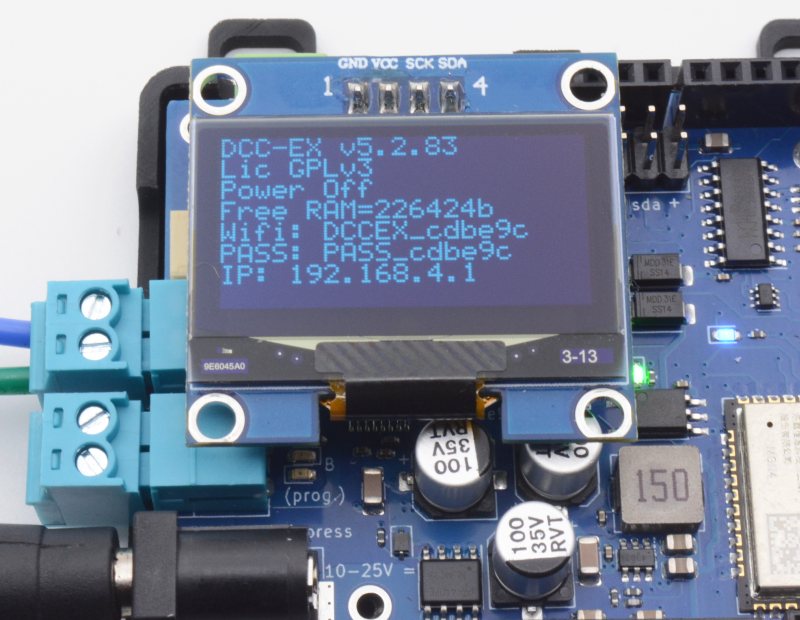{ width="200px" }  
OLED Status Display

### Connecting Your Throttle (controller)

#### Connect the Smart Device to the EX-CSB1 AP Network

The **EX-CSB1** will power up in WiFi **Access Point mode** as configured out of the box, with its own unique WiFi network SSID of `DCCEX_xxxxxx` and password of `PASS_xxxxxx` (where **xxxxxx** is the last 6 digits of the MAC address of the **EX-CSB1**), both of which will be visible on the OLED display (or [Serial Monitor](../../reference/tools/serial-monitor.md) log). After it boots you can connect with a WiFi throttle like [Engine Driver](../../throttles/engine-driver.md) or [ThrottleCard](../../throttles/throttlecard.md).

This quick start covers initial testing with the [Engine Driver](../../throttles/engine-driver.md) app, though it is a broadly similar process when using any other throttle app on a Smart device.

For a USB Connection with [EX‑WebThrottle](../../products/ex-webthrottle/index.md) or [JMRI](https://dcc-ex.com/throttles/software/jmri.html) and a computer, please see the full [CSB1 operating manual](ex-csb1-full-guide.md).

**Access Point (AP) mode** creates a separate WiFi network on the Command Station itself, whereas **Station (STA) mode** allows the Command Station to join as a WiFi device on your home or layout WiFi network. We have the **EX-CSB1** set to default to **Access Point (AP) mode** for the convenience of being able to get up and running quickly.

To configure your **EX-CSB1** to connect to your home network, see [WiFi Configuration](../../products/ex-csb1/config-wifi-esp32.md).

The WiFi LED will illuminate once WiFi is configured and ready as an Access Point (or Station if reconfigured for STA mode.)

In your smart device's system WiFi settings, select the network settings and find an available network that begins with 'DCCEX\_'.

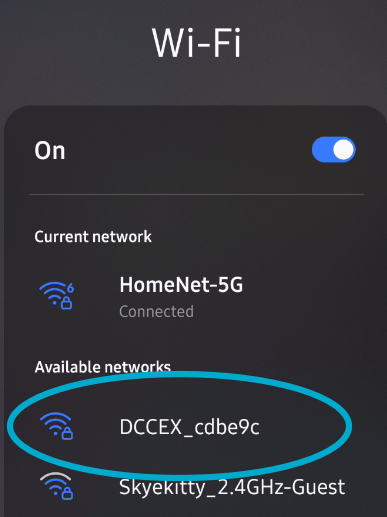{ width="200px" }  
Smart Device Available Network Screen

Click on that network to see the next screen to enter your password. Notice the password is just 'PASS\_' followed by the same 6 digits in the network name (called a 'SSID').

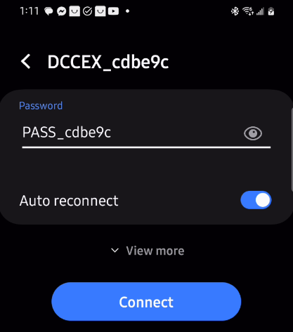{ width="200px" }  
Smart Device AP Password Entry

#### Run the Engine Driver Setup Wizard

Open the [Engine Driver](../../throttles/engine-driver.md) app on your Android smart device:

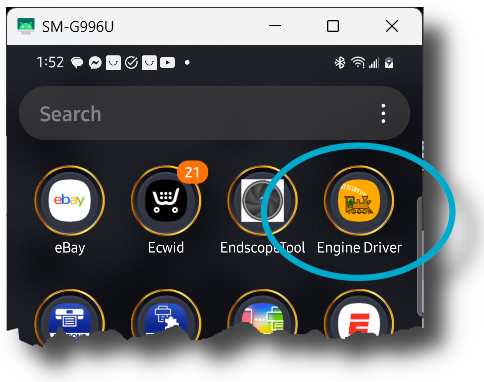{ width="200px" }  
Engine Driver App Icon

The very first time the app is launched the 'Welcome to Engine Driver' **Intro/Setup Wizard** is shown. The wizard will ask to grant the app the required permissions and allow you to select some basic preferences for the theme and throttle layout.

If you have already used [Engine Driver](../../throttles/engine-driver.md), you can run the wizard again at any time from the app menu (from the 'Connection' screen only). Any settings from previous runs of the wizard will be maintained.

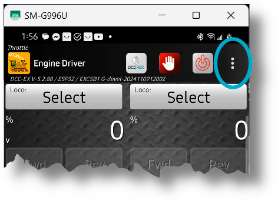{ width="200px" }  
Engine Driver App Menu

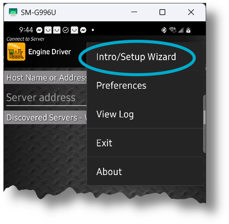{ width="200px" }  
Engine Driver Intro/Setup Wizard

The Wizard allows you to set or change appearance options and, most importantly, choose to use [DCC-EX Native Commands](../../throttles/withrottle-vs-native-protocol.md) instead of [wiThrottle Protocol](../../throttles/withrottle-vs-native-protocol.md):

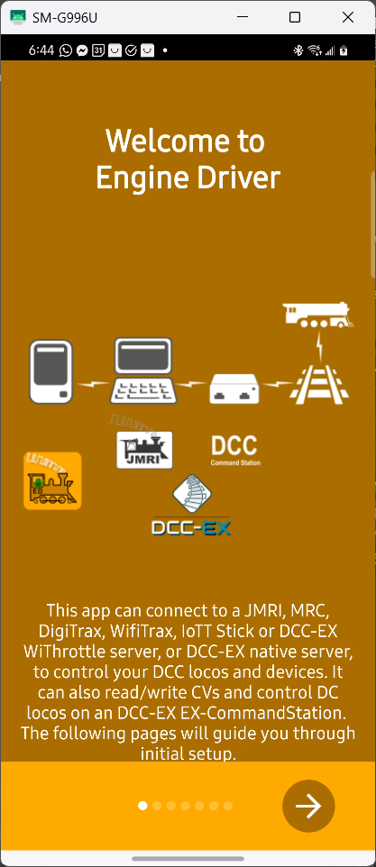{ width="200px" }  
Engine Driver Wizard Opening Screen

Scroll through the other screens setting your preferences until you get the the DCC-EX screen and make sure to select the option to use an EX-CommandStation.

This setting will automatically add useful buttons and switch to using the [DCC-EX Native Commands](../../throttles/withrottle-vs-native-protocol.md) instead of [wiThrottle Protocol](../../throttles/withrottle-vs-native-protocol.md) (you can always switch back and forth if you need to connect to a WiThrottle specific device):

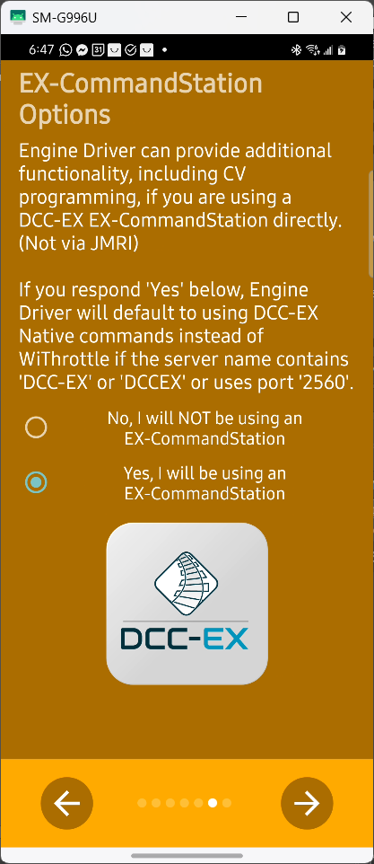{ width="200px" }  
Engine Driver Wizard DCC-EX Select

After choosing the DCC-EX option above and pressing the checkmark to finish the Wizard, the opening [Engine Driver](../../throttles/engine-driver.md) screen will change to look like *Figure: DCC-EX Protocol Bottom Selector* below with an added option at the bottom of the screen for 'Connection Protocol'.

'Auto' for Automatic is now the default.

You can manually switch between [DCC-EX Native Protocol](../../throttles/withrottle-vs-native-protocol.md) and [wiThrottle Protocol](../../throttles/withrottle-vs-native-protocol.md) if you go to a club or use another type of Command Station that requires the [wiThrottle Protocol](../../throttles/withrottle-vs-native-protocol.md), but generally the 'Auto' setting will do so automatically.

The [DCC-EX Native Protocol](../../throttles/withrottle-vs-native-protocol.md) allows for more powerful, expanded capabilities when connected to an [EX‑CommandStation](../../products/ex-commandstation/index.md):

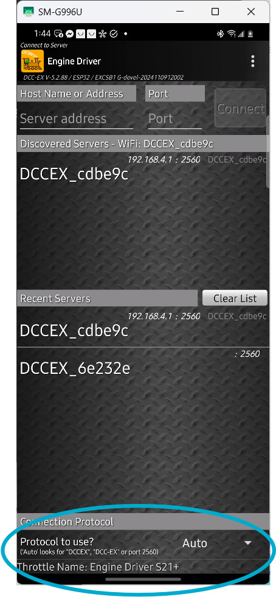{ width="200px" }  
DCC-EX Protocol Bottom Selector

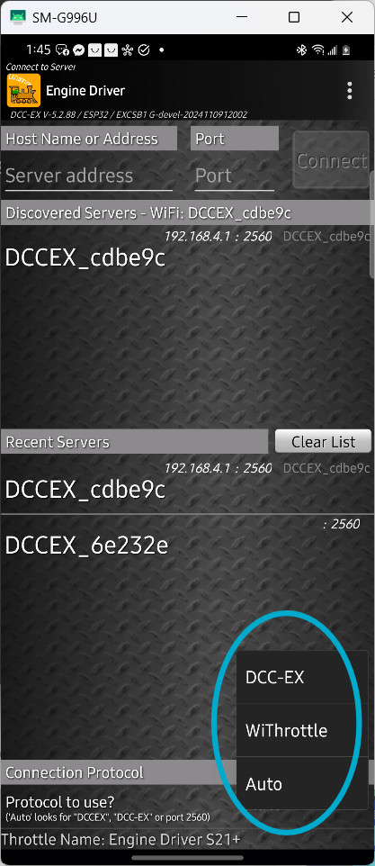{ width=200px }  
DCC-EX Protocol Men

#### Connect Engine Driver to EX-CommandStation

[Engine Driver](../../throttles/engine-driver.md) should find the Command Station automatically and show it's SSID in the 'Discovered Servers' List. Simply select yours by clicking on it. The last 6 characters of the SSID will be unique to your Command Station.

If the list is empty, try entering it manually by putting `192.168.4.1` in the 'Server Address' and `2560` for the 'Port'. If that still does not work, see the Section on WiFi here todo XXX.

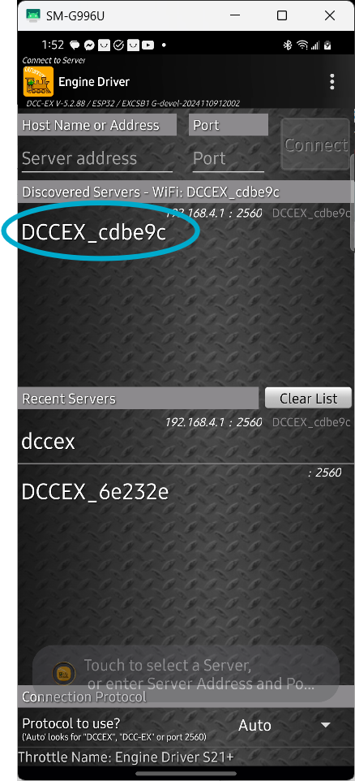{ width="200px" }  
Command Station Connect

#### Acquire Your Loco

Once you have connected to your command station, the next screen will display the throttle controls. They will be greyed out until you select a loco to control.

Press the select button and enter the address for your loco. Here you can see we are acquiring loco ``3`` (the default address for almost all locos as they come from the box).

(Once you are happy that your **EX‑CommandStation** is fully functioning you can change the DCC address of your locos using [these instructions](../../throttles/loco-programming/index.md).)

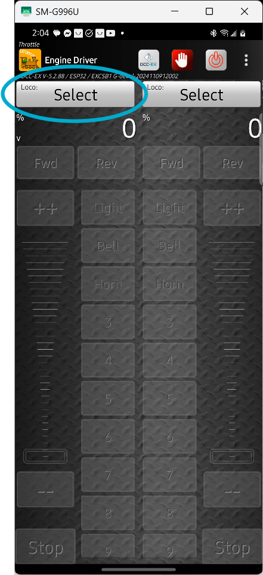{ width="200px" }  
Press Loco Select Button

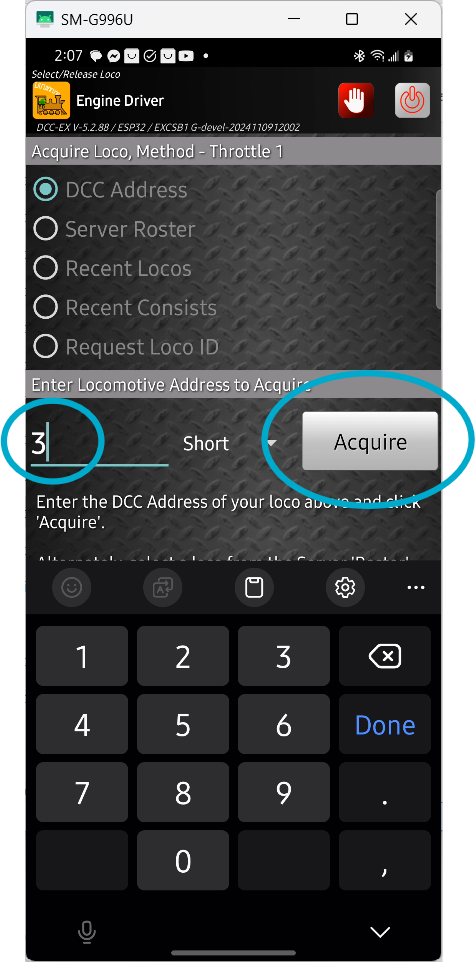{ width="200px" }  
Acquire Loco by its address

The throttle screen reappears and the controls are active. You will also see 3 icons at the top of the display, a special DCC-EX button, an 'emergency stop' button, and a 'track power' button.

Press the red 'power' button to turn on the track power, the button should turn green and your track power should be on (the track output LEDs on your motor driver should light).

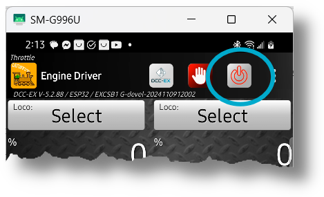{ width="200px" }  
Turn On Track Power

#### Run Trains

Move the slider control up slowly, operate the horn and light buttons, and you should be running trains!

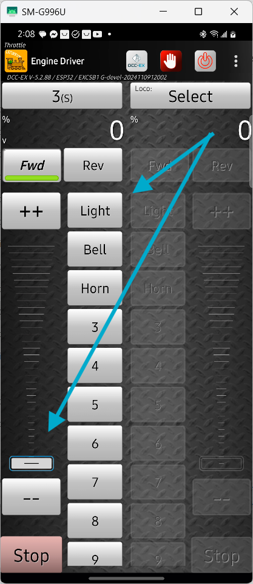{ width="200px" }  
Operate Controls to Run trains

----

## Additional information

### Confirm startup

{ width="200px" }  
EX-CSB1 Startup - OLED screen

At startup of the **EX-CSB1** the OLED screen shows useful information.

| Line | key | Meaning |
| :--: | :--: | --- |
| 1 | DCC-EX | EX-CommandStation version number |
| 2 | Lic | The licence under which the EX-CommandStation code is published |
| 3 | Power | Power State. ON / OFF / JOIN / etc. |
| 4 | Free RAM | Available RAM |
| 5 | Wifi: | The SSID / Network name |
| 6 | PASS: | The password for the Network |
| 7 | IP: | The IP Address of the WiThrottle / Native server |

### Adding an EX-8874 Motor Shield

You can add an **EX‑MotorShield8874** to the **EX-CSB1** to increase the number of outputs from 2 to 4.

Note that the **EX‑Installer** does not have a simple way to configure the additional outputs so you will need to use the [TrackManager](../../enhance/trackmanager/index.md) feature to configure the outputs as needed in ``myAutomation.h`` in the ``Advanced Configuration`` page of **EX‑Installer**.

For example, to always set outputs C and D to be the second and third DCC MAIN outputs, you would create a AUTOSTART sequence that sets both outputs C and D to DCC MAIN mode in <cite>myAutomation.h</cite>.

```c++
AUTOSTART SET_TRACK(A,MAIN) SET_TRACK(B,PROG) SET_TRACK(C,MAIN) SET_TRACK(D,MAIN) POWEROFFDONE
```

### DCC Operation

The **EX-CSB1** is set to operate in DCC mode by default. If you want to switch to any of the outputs to DC mode, you can find instructions on how to do that on the [TrackManager](../../enhance/trackmanager/index.md) page.

### Booster Mode

The **EX-CSB1** as the name implies can operate as a Command Station or a Booster. See [EX-CSB1 as a booster page](https://dcc-ex.com/ex-commandstation/rtr-booster.html) for instructions on how to use the **EX-CSB1** as a booster.

### Full EX-CSB1 Operating Manual

[EX-CSB1 Operating Manual](ex-csb1-full-guide.md). [Design files](../../reference/microcontrollers/ex-csb1/csb1-technical.md)

----

## Next Steps

If you are happy with the default configuration of your **EX‑CommandStation/Booster One Express** there is nothing more you need to do.

If you want to change the way the WiFi is configured, just click next or go the [WiFi Configuration](../../products/ex-csb1/config-wifi-esp32.md) page.

If you want to look at some other options to use as a controller (throttle) then have a look at the [Choosing a Throttle (Controller)](../../throttles/throttles.md) page.

If you want to add a roster, turnout/points, routes or automations look at the [EXRAIL Automation & Animation](../../enhance/exrail/index.md) page.

--8<-- "snippets/abbr.md"
